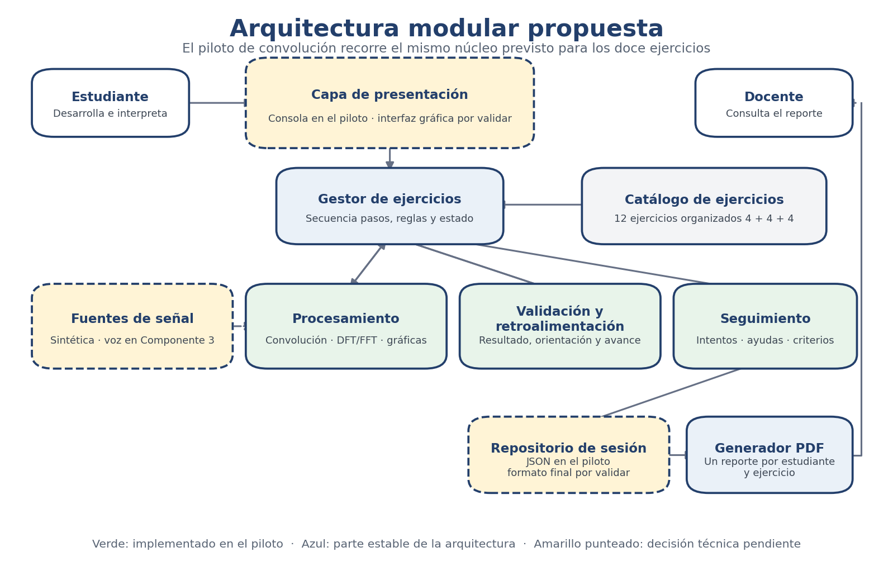

# Arquitectura inicial

La propuesta separa el software por responsabilidades. De este modo, la interfaz, el almacenamiento y las fuentes de señal pueden evolucionar sin reescribir los cálculos ni las reglas de los ejercicios.

## Módulos principales

- **Presentación:** recibe las respuestas y muestra señales, gráficas, ayudas y retroalimentación.
- **Gestor de ejercicios:** controla la secuencia de pasos, las reglas y el estado de la sesión.
- **Fuentes de señal:** suministra señales sintéticas y, cuando se valide su mecanismo, segmentos de voz para el Componente 3.
- **Procesamiento:** ejecuta convolución, DFT/FFT y las operaciones numéricas de cada ejercicio.
- **Validación y retroalimentación:** comprueba respuestas objetivas y entrega orientaciones progresivas.
- **Seguimiento:** registra intentos, correcciones, ayudas, respuestas y criterios.
- **Persistencia:** conserva la sesión en una estructura recuperable.
- **Reportes:** construye un PDF por estudiante y ejercicio.

La descripción completa, el flujo de información y las decisiones técnicas pendientes están disponibles en el [documento de arquitectura](Arquitectura_Inicial_Sistema.pdf).
